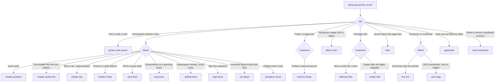

# 23rd

23rd is a shadcn registry of opinionated components. Install with the shadcn CLI, then own the source. Every published item is a single React client component. This skill is the playbook. Open the linked files before inventing props.

This folder is checked in twice and the copies must stay identical. `skills/23rd/` is the path the skills CLI and [skills.sh](https://skills.sh) discover. `.cursor/skills/23rd/` is what Cursor loads as `/23rd` in this repo.

| File | Read it when |
| --- | --- |
| [components.md](components.md) | Picking a component, pitfalls, one working example |
| [apis.md](apis.md) | Writing props, callbacks, or theme behavior |
| [recipes.md](recipes.md) | Assembling a hero, 404, footer, or accent |
| [conventions.md](conventions.md) | Adding a component to this repo |

Do not invent props, CSS variables, or variants. If a prop is not in [apis.md](apis.md), it does not exist.

## Install

The consumer project must already be a shadcn project. React files import `cn` from `@/lib/utils` and land in `components/ui/`. React components are `"use client"`.

Replace `<name>` with the kebab-case item (`shader-gradient`, `gooey-color-picker`, …).

```bash
pnpm dlx shadcn@latest add @23rd/<name>
npx shadcn@latest add @23rd/<name>
yarn dlx shadcn@latest add @23rd/<name>
bunx --bun shadcn@latest add @23rd/<name>
```

GitHub source, if `@23rd` is not configured:

```bash
pnpm dlx shadcn@latest add radiumcoders/23rd.dev/<name>
```

Imports after install:

```tsx
import { ShaderGradient } from "@/components/ui/shader-gradient"
```

npm dependencies the registry declares:

| Item | Dependencies |
| --- | --- |
| `gooey-color-picker` | `motion` |
| `ring-tower` | `three` |
| `mech-keyboard` | `three` |
| every other item | none |

Published index: `https://23rd.dev/r/registry.json`. Docs: `https://23rd.dev/docs`.

## Choose



Disambiguation that agents get wrong:

| User says | Use | Not |
| --- | --- | --- |
| Color picker, swatch, hex, hue, alpha, eyedropper | `gooey-color-picker` | Any shader. Shaders are not controls. |
| Soft gradient behind a headline | `shader-gradient` | `gooey-color-picker` |
| Fire, heat under a hero | `shader-anime-fire` | `dithered-404` unless the page is a 404 |
| 404 that burns under the cursor | `dithered-404` | `shader-anime-fire` |
| Snake game, Nokia, retro 404 or 500 you can play | `snake-404` | `dithered-404` (fire, not a game) |
| Image that un-dithers, scan line, enhance or processing reveal | `dither-scan` | `dithered-404` (a 404 glyph, not your image) |
| Overscroll rubber band, aurora at the bottom | `stretchy-footer` | `folio` |
| Page leans while scrolling | `folio` | `stretchy-footer` (that one stretches, it does not tilt) |
| Stars that speed up when you scroll | `radiant-lines` | `logo-burst` |
| Logo explodes into lines | `logo-burst` | `ascii-logo` |
| Isometric cube, stairs, bar chart, pixel-tile figure | `iso-lattice` | `logo-burst` (lines, not a figure) |
| ASCII letters that shove, scatter, and fall | `ascii-logo` | `ascii-fluid` (trails, not a wordmark) |
| CRT notation, phosphor, staves | `phosphor-score` | `shader-sky` |
| Chrome, liquid metal, gold ribbons | `shader-metal` | `shader-gradient` (a color wash, not a material) |
| Rings, bands, or a tower of screenshots that spins | `ring-tower` | `shader-metal` (no images) |
| A face / orb / mascot | `live-orb` | `logo-burst` |
| Typing effect, typewriter, text that types itself | `typewriter` | `ascii-logo` (a wordmark, not prose) |
| Keyboard, keycaps, record a shortcut, onboarding hotkey step | `mech-keyboard` | `typewriter` (types prose, not chords) |

There is one variant enum in the whole registry: `LiveOrb` `variant` is `"white" | "black" | "webgl" | "custom"`. Nothing else has `variant`.

## Compose

Backgrounds and shaders fill the parent. They do not create a page.

```tsx
<section className="relative isolate min-h-svh overflow-hidden bg-background">
  <ShaderGradient />
  <div className="relative z-10">{/* content */}</div>
</section>
```

Same shell for `ShaderAnimeFire`, `ShaderFire`, `ShaderSky`, `AsciiFluid`, `LogoBurst`, `PhosphorScore`, `IsoLattice`, `Dithered404`, and `Snake404`. Give the parent a height. Put UI in a later stacking context (`relative z-10`).

`ShaderMetal` uses the same shell but is transparent: the ribbons and their shadows sit on the parent's background, so set one (`bg-background`). The ribbons cross the middle; put copy top-left.

`RadiantLines` is transparent and warps with scroll. Inside an overflow div, pass the scroller (`containerRef`) and make the canvas `sticky top-0 h-svh`. Omit the scroller to use the window.

`Folio` and `StretchyFooter` are the scroller by default. Put the page in `children`. For a real document, set `windowScroll` and mark the tilting or lifting element (`data-folio-page` or `data-stretchy-page`).

`Typewriter` is a whole machine drawn in SVG that scales to fit its parent, centered, with the sheet growing above it as lines feed. Give the parent a height (roughly 2:1 wide). `color` sets the body enamel (default mint `#8EC3B5`); everything else is fixed chrome, rubber, and an ivory sheet. With `interactive` (default on) visitors can click it and type, which stops the script.

`GooeyColorPicker` is an inline control. It opens upward from the trigger. Give it room (`overflow-visible`); do not clip it in `overflow-hidden`.

`LiveOrb` is a fixed square (`size`, default `280`). It does not fill the viewport. The body stays put; only the eyes move.

## Theme

Default `theme` is `"auto"` wherever a component has that prop (`"light" | "dark" | "auto"`). Resolution order:

1. `theme="dark"` or `theme="light"` forces it.
2. `auto`: `html.dark` → dark, `html.light` → light, then `data-theme="dark"|"light"`, then `prefers-color-scheme`.

That matches shadcn / `next-themes` with `attribute="class"`. There is no shared CSS-variable theme API.

Exceptions:

- Passing `colors` to `ShaderGradient`, `ShaderAnimeFire`, `ShaderFire`, or `ShaderSky` replaces the stock palette and does not swap with dark mode. Omit `colors` to get the light/dark pair.
- Passing `color` (and `backgroundColor` where it exists) overrides ink. Omit it to follow the theme.
- `PhosphorScore` canvas is transparent in both themes; the parent paints the background.
- `Folio` tilt peaks at an internal 16°. It is not a prop. The lean follows wheel speed, so trackpads and mice lean alike. Do not add a tilt prop that does not exist. `playFolioDemo` only previews the lean; it is not the interaction.

`prefers-reduced-motion: reduce` is honored by the canvas and motion components (still frame, no tilt, no stretch). Do not add a `reducedMotion` prop.

## Catalog

Categories match `content/docs/components/meta.json`.

| Name | Category | One line |
| --- | --- | --- |
| `dither-scan` | AI Components | 1-bit dithered image a diagonal scan line clears in N passes |
| `logo-burst` | Background | Hair-line tentacles explode from center, then breathe |
| `phosphor-score` | Background | Vertical CRT score; notes fall, bloom, flare |
| `radiant-lines` | Background | Hyperspace streaks; warp follows scroll |
| `ascii-fluid` | Background | Pointer trails quantized to an ASCII brightness ramp |
| `iso-lattice` | Background | Isometric tiles build solid figures from the floor up |
| `ring-tower` | Background | three.js tower of tilted image bands; drag to spin, neighbors counter-turn |
| `shader-gradient` | Shaders | Quiet WebGL wash behind heroes and empty states |
| `shader-anime-fire` | Shaders | Cel-shaded flames licking up from the bottom |
| `shader-sky` | Shaders | Clear sky or rain; optional dotted window glass |
| `shader-metal` | Shaders | Chrome, gold, copper, or graphite ribbons; pointer key light |
| `stretchy-footer` | Footers | Dia-style rubber overscroll with an aurora floor |
| `live-orb` | Characters | Lit sphere; eyes follow the pointer |
| `ascii-logo` | Characters | ASCII wordmark: hover shove, click scatter / fall / gather |
| `dithered-404` | Pages | Bayer 404 burned by a fireball cursor, then reforms |
| `snake-404` | Pages | Dot-matrix 404 eaten by a Nokia-style snake; arrow keys take over |
| `folio` | Sections | Page leans on scroll, then springs flat |
| `gooey-color-picker` | Components | Swatch opens into hue, alpha, and hex under an SVG goo filter |
| `typewriter` | Components | A real typewriter in SVG: keys press, typebars strike, the carriage steps |
| `mech-keyboard` | Components | Isometric 75% keyboard illustration; presses with yours and records shortcuts |

## Minimal installs that must be right

Quiet hero wash:

```bash
pnpm dlx shadcn@latest add @23rd/shader-gradient
```

```tsx
"use client"

import { ShaderGradient } from "@/components/ui/shader-gradient"

export function Hero() {
  return (
    <section className="relative isolate min-h-svh overflow-hidden bg-background">
      <ShaderGradient />
      <div className="relative z-10 mx-auto flex min-h-svh max-w-xl flex-col items-center justify-center px-6 text-center">
        <h1 className="text-4xl font-medium tracking-tight">Ship the sharper default</h1>
      </div>
    </section>
  )
}
```

Color control (not a background). Uncontrolled unless `value` is passed. Omitted color is `{ h: 320, s: 90, l: 58, a: 1 }`, not the `{ h: 210, s: 90, l: 55, a: 1 }` this example passes.

```bash
pnpm dlx shadcn@latest add @23rd/gooey-color-picker
```

```tsx
"use client"

import { GooeyColorPicker } from "@/components/ui/gooey-color-picker"

export function Accent() {
  return (
    <GooeyColorPicker
      defaultValue={{ h: 210, s: 90, l: 55, a: 1 }}
      onChange={(color, css) => {
        console.log(color, css)
      }}
    />
  )
}
```

Full prop tables are in [apis.md](apis.md). More assemblies are in [recipes.md](recipes.md).

## Adding a component

Only when the task is to add one to this repository. Follow [conventions.md](conventions.md). Short version: `registry/<name>/` with a vanilla engine, a React wrapper, and a `registry.json`, a doc at `content/docs/components/<name>.mdx`, a row in `content/docs/components/meta.json`, then `pnpm registry:build` and `pnpm test`.
